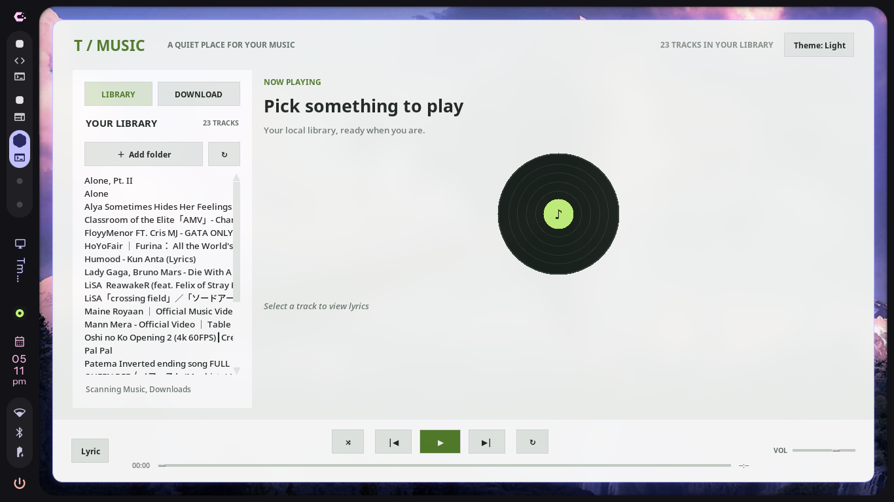
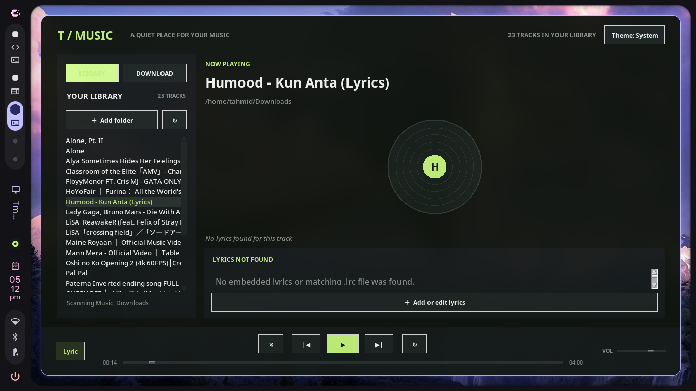

# Tmusic 2.0

Tmusic is a Tkinter desktop music player and downloader for Linux, Windows, and
macOS. Linux desktops can use MPRIS controls and a tray menu; the interface
includes shuffle, repeat, editable MP3 metadata, and an inline lyrics panel.


[See the v1-to-v2 changes in the changelog](./changelog.md).

## Features

- Scan multiple folders for MP3, FLAC, OGG, and WAV tracks.
- Play, pause, seek, adjust volume, repeat tracks or the library, and shuffle
  through each track before starting another round.
- Show or hide synchronized or plain lyrics inline. Lyrics can come from MP3
  tags or a matching `.lrc` sidecar.
- Right-click an MP3 and choose **Edit** to update its title and artist,
  rename the audio file, or attach/edit lyrics embedded in its ID3 tags.
- Download audio to `~/Music` by default, or choose a different destination.
- Cycle between system, dark, and light themes.
- Use Space for play/pause and Ctrl+Left / Ctrl+Right to change tracks.

Downloads do not automatically include lyrics. Add lyrics with **Edit** or
place a same-named `.lrc` file beside the audio.

## Install from a release

Download the latest archive from the
[Tmusic Releases page](https://github.com/InvaerLabs/Tmusic/releases/latest).
Choose your operating system and CPU architecture (`x86_64` or `arm64`):

- **Linux:** extract `Tmusic-Linux-x86_64.tar.gz` or
  `Tmusic-Linux-arm64.tar.gz`, then run `chmod +x Tmusic && ./Tmusic`.
- **Windows:** extract `Tmusic-Windows-x86_64.zip` or
  `Tmusic-Windows-arm64.zip`, then launch `Tmusic.exe`.
- **macOS:** extract `Tmusic-macOS-x86_64.zip` or
  `Tmusic-macOS-arm64.zip`, then open `Tmusic.app`.

The release workflow builds native x86_64 and ARM64 packages for Linux,
Windows, and macOS. FFmpeg must be installed separately for downloading and
converting audio. Linux MPRIS and tray controls require the appropriate
system D-Bus, GObject, GTK, and AppIndicator libraries.

On Linux, closing the window or pressing **Super+Q** hides it while playback
and MPRIS remain active. Use the tray's **Show Tmusic** and **Quit Tmusic**
actions to restore the window or exit. If a tray backend is unavailable,
closing the window exits rather than leaving an inaccessible background
process.

## Library, downloads, and settings

Tmusic scans `~/Music` on first run. Use **Add folder** to include other
locations. If the old project `downloads/` directory exists, its tracks are
also scanned.

In the Download tab, choose a destination and click **Paste link & download**
to use a copied URL. Downloads are converted to MP3 at 192 kbps, and the
library refreshes when a download completes. Only download content you have
permission to use. Tmusic does not bypass sign-in or anti-bot checks.

Preferences are stored in the platform's user configuration directory:

- Linux: `${XDG_CONFIG_HOME:-~/.config}/tmusic/settings.json`
- macOS: `~/Library/Application Support/tmusic/settings.json`
- Windows: `%APPDATA%\\tmusic\\settings.json`

## Lyrics

For sidecar lyrics, put a file beside the audio with the same name and an
`.lrc` extension. The parser supports `[mm:ss.xx]` timestamps, multiple
timestamps per line, and `[offset:+/-milliseconds]`.

To embed lyrics in an MP3, right-click its library entry, choose **Edit**, and
paste lyrics or select **Open .lrc**. The **Lyric** button toggles the inline
panel. Synchronized lines can be clicked to seek. Linux widgets that support
MPRIS `xesam:asText` can display embedded lyrics metadata.

## Development

Install dependencies and run the tests:

```sh
python -m pip install -r requirements.txt
python -m unittest discover -s tests -v
python -m compileall -q main.py player.py downloader.py preferences.py MPRIS.py
```

The release workflow builds and publishes packages when a `v2.0` or `v2.0.*`
tag is pushed. Manual workflow runs upload packages as GitHub Actions
artifacts.

# Screenshots


