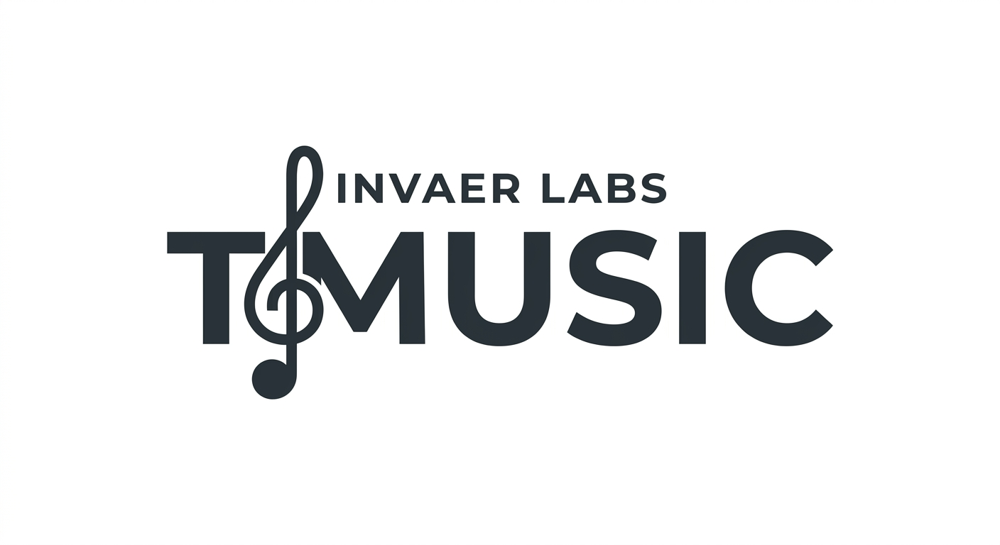

# Tmusic - *by* **Invaer Labs**



Tmusic is an open-source desktop music player and downloader built with Python and a local HTML/Tailwind interface hosted by pywebview. Designed for music lovers, gamers, and power users, it offers a distraction-free offline listening experience across Linux, Windows, and macOS.

Unlike resource-heavy streaming platforms, Tmusic focuses on maximum performance and flexibility, allowing users to build a truly customized offline library.

## Key Advantages

* **Low-idle Playback Core:** Playback, tray controls, and media-key integration stay in a small background process. The WebView and its browser engine run separately and exit when the window closes, freeing their memory while music continues.
* **Unrestricted Audio Library:** Seamlessly download and play audio content that is typically unavailable on mainstream streaming platforms like Spotify, such as custom Anime Music Videos (AMVs), tracks with unique character voiceovers, custom beats, and independent remixes.

## Features

* **Multi-Format Playback:** Automatically scans and indexes MP3, FLAC, OGG, and WAV tracks from multiple user-defined local directories.
* **Instant Library Search:** Filter the library as you type, press Enter to play the first match, and press Ctrl+F from anywhere to jump back to the search box.
* **Built-in Audio Downloader:** Downloads and converts audio to MP3 at a bitrate you select: 192, 256, or 320 kbps. Powered by PyAV's bundled media libraries and LAME encoding, requiring no external system FFmpeg executable.
* **Synchronized Inline Lyrics:** Supports plain and synchronized lyrics using embedded ID3 tags or matching .lrc sidecar files. Timestamps are fully interactive, enabling click-to-seek functionality.
* **Metadata and ID3 Tag Editor:** Right-click any track in the library to edit the title, artist name, rename the physical audio file, or embed custom lyrics. Preview cover art, import LRC files, and get warned before discarding unsaved edits.
* **Album Artwork:** Displays embedded cover art in a sleeve-and-record view with a smooth playback animation. Artwork is always visible.
* **Flexible UI Themes:** Select System, Light, Dark, or the animated Stars theme in Settings. The player window adapts its size to the display.
* **Library and Updates:** Add or remove scanned folders and check GitHub for the latest release from Settings.
* **Native Desktop Integration:** Supports Linux MPRIS, Windows System Media Transport Controls (SMTC), macOS Now Playing, and a system tray menu on all three platforms. Each release build bundles only its platform's media-control integration alongside the tray support.
* **Close to Tray:** The custom title bar provides Minimize and Close controls. Either closes the WebView process and frees its browser memory while playback and media controls keep running in the background. Closing during a download asks before cancelling it. Open Tmusic again from the tray to restore the current live library and playback state; Quit Tmusic in the tray menu exits the background core.

## Installation

### From Pre-built Releases
Download the latest package for your specific operating system and CPU architecture from the Releases page:

* **Windows:** Run `Tmusic-Windows-x86_64-Setup.exe` or `Tmusic-Windows-arm64-Setup.exe`.
* **Linux:** Make the `Tmusic-Linux-x86_64.AppImage` or `Tmusic-Linux-arm64.AppImage` executable and launch it.
* **macOS:** Open `Tmusic-macOS-x86_64.dmg` or `Tmusic-macOS-arm64.dmg` and drag Tmusic into Applications.

### From Source (Development)
To run the project locally or contribute to development, ensure you have Python installed, then execute the following commands:

```bash
# Clone the repository
git clone https://github.com/InvaerLabs/Tmusic.git
cd Tmusic

# Install Python dependencies
pip install -r requirements.txt

# Build the local web interface
cd src/webui
npm ci
npm run build
cd ../..

# Run the application
python src/main.pyw
```

## Why you choose Tmusic?

Tmusic is designed for local libraries and downloads that you have permission to make. Its UI is separate from the playback core so closing the window releases WebView memory without interrupting music.

Memory use depends on operating system, audio backend, library size, and artwork. The separate UI process is intended to keep idle/background use low; no fixed RAM limit is guaranteed.


## Keyboard Shortcuts

* **Space:** Play / Pause playback
* **Ctrl + F:** Focus library search
* **Ctrl + Left Arrow:** Previous track
* **Ctrl + Right Arrow:** Next track
* **Super + Q (Linux):** Close the UI window to the system tray. Playback continues; an active download requires confirmation before cancellation.

## Architecture and File Structure

* `src/main.pyw`: Starts the Nuitka-built background playback core or on-demand WebView child.
* `src/core/player.py`: Audio playback logic and playlist states.
* `src/core/downloader.py`: Network requests, audio downloading, and MP3 conversion.
* `src/utils/preferences.py`: Reads and writes configuration data (`settings.json`).
* `src/platform_integration/`: Platform-specific media controls and system-tray integration.
* `src/ui/web_bridge.py`: Background playback core, authenticated local IPC, and WebView child API. Each new window requests a full live snapshot from the core; playback state stays in memory rather than a second state file.
* `src/webui/`: Vite/Tailwind interface compiled locally and bundled with the application.

## License

This project is licensed under the MIT License. See the [License](LICENSE) file for details.

## Screenshots


